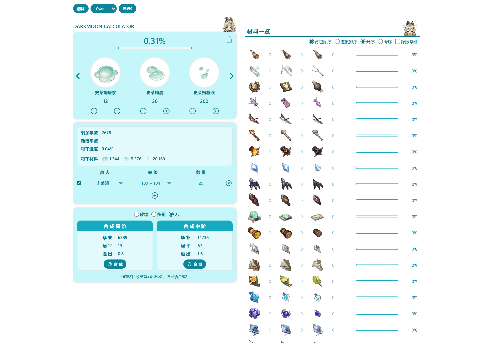
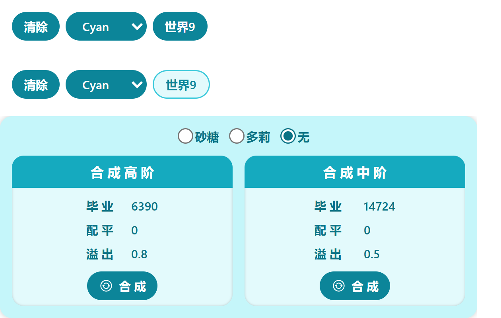

# Darkmoon Calculator · React 重构版

原项目 [lyx314/Darkmoon-Calculator](https://github.com/lyx314/Darkmoon-Calculator) 的完整重构实现：
**React 19 + TypeScript + TailwindCSS v4 + Vite**。核心计算逻辑与原版做过数值对拍；在此基础上开始做功能裁剪与体验优化，见文末「优化记录」。

> 原项目没有改动，本仓库是独立新建的项目。



---

## 快速开始

```bash
pnpm install      # 安装依赖
pnpm dev          # 本地开发，默认 http://localhost:5173
pnpm build        # 类型检查 + 生产构建
pnpm preview      # 预览构建产物
pnpm test         # 单元测试 / 与原版的数值对拍
pnpm typecheck    # 仅做类型检查
```

> 首次用 pnpm 11 安装时，`esbuild` 的安装脚本需要放行，仓库里的 `pnpm-workspace.yaml` 已经配置好
> `onlyBuiltDependencies: [esbuild]`，无需手动执行 `pnpm approve-builds`。

**部署**：`pnpm build` 后把 `dist/` 整个目录传到任意静态托管即可（`vite.config.ts` 里 `base: "./"`，
放在 GitHub Pages 二级目录也能正常工作）。

---

## 技术栈

| 关注点 | 原版 | 重构版 |
| --- | --- | --- |
| 视图 | 手写 HTML + 命令式 DOM 操作 | React 19 函数组件 |
| 状态管理 | 类实例 + 直接操作 DOM | **zustand 5**（单一 store + 细粒度 selector） |
| 类型 | 无 | TypeScript（`strict` 全开） |
| 样式 | 7 个手写 CSS 文件 | TailwindCSS v4 + CSS 变量主题 |
| 数值精度 | 自研 `bignumber.mjs`（86 KB，十进制精确） | 原生 `number` 运算（无额外依赖） |
| 图标 | ionicons CDN | `react-icons`（Ionicons 5，无外部 CDN 依赖） |
| 截图导出 | dom-to-image + FileSaver | `html-to-image` + 原生 Blob 下载 |
| 构建 | 无（直接双击 HTML） | Vite 7 |

---

## 目录结构

```
src/
├── domain/                 纯逻辑，不依赖 React
│   ├── types.ts            领域类型（字段名与原版数据格式保持一致）
│   ├── calculator.ts       合成模拟器 + 进度/权重公式（移植自原版 calculator.js）
│   ├── ordering.ts         材料排序 / 上一个下一个的切换顺序
│   ├── craftMode.ts        合成加成角色的三选一转换
│   ├── materialImage.ts    物品 key -> 图片路径（kebab-case）
│   └── themes.ts           13 套配色主题清单
├── data/
│   ├── materials.ts        53 种材料 / 82 种敌人（由脚本从原版数据生成）
│   └── defaults.ts         默认状态
├── store/
│   ├── useDarkmoonStore.ts zustand store：唯一状态源 + 全部 action + 持久化订阅
│   ├── selectors.ts        派生数据 hooks（进度、每车统计、合成统计、清单行）
│   └── storage.ts          localStorage 读写 + 脏数据规范化
├── components/
│   ├── NavBar.tsx          清除 / 导入 / 导出 / 主题 / 世界9
│   ├── MaterialPanel.tsx   材料数量面板（进度、加减、锁定、上一个/下一个）
│   ├── EnemySection.tsx    敌人配置与每车统计
│   ├── CraftSection.tsx    合成高阶 / 中阶换算
│   ├── MaterialList.tsx    材料一览（排序、隐藏毕业）
│   ├── NumberInput.tsx     带校验的数量输入框
│   └── ui/
│       ├── buttonStyles.ts 全站统一的按钮样式
│       └── ProgressBar.tsx 进度条（带过渡动画与 aria 语义）
├── App.tsx / main.tsx / index.css
```

---

## 状态管理

用 **zustand 5** 管状态，刻意分成「store 只放源状态」和「selector 负责派生」两层：

- **`useDarkmoonStore`**：只持有 `data`（结构与原版 localStorage / 导出 JSON 完全一致）和全部 action。
  没有把「进度百分比」「每车材料」这类派生值塞进 store，避免状态重复导致不一致。
- **`selectors.ts`**：`useNumbers()` / `useEnemyStats()` / `useCraftStats()` / `useListRows()` 等 hooks，
  各自只订阅需要的那几片状态，再用 `useMemo` 缓存派生结果 —— 合成模拟一次要跑几万次迭代，
  不能每次渲染都重算。
- **`useDarkmoonActions()`**：用 `useShallow` 一次性取出所有 action。action 引用恒定，不会引起额外渲染。
- **持久化**：模块级 `subscribe` 比较 `state.data` 引用决定是否写 localStorage，
  所以任何 action 都不需要手动调用保存，也不会有遗漏。

组件拿状态就是普通 hook 调用，不再有 Provider 包裹：

```tsx
const numbers = useNumbers();
const stats = useEnemyStats();
const { setNumberAt, stepNumber } = useDarkmoonActions();
```

---

## 功能对照

| 原版功能 | 重构版实现 | 状态 |
| --- | --- | --- |
| 三种品阶材料数量输入（0 ~ 9999 校验） | `NumberInput` + `setNumberAt` | ✅ |
| 加减按钮、进度百分比与进度条 | `MaterialPanel` | ✅ |
| 上一个 / 下一个材料切换（精英优先、按 id 升序） | `goPrevMaterial` / `goNextMaterial` | ✅ |
| 锁定初始数量 → 计算「新增车数」 | `lockCurrentNumbers` | ✅ |
| 敌人配置（敌人 / 等级区间 / 数量 / 启用勾选 / 删除 / 新增） | `EnemySection` | ✅ |
| 每车材料、每车进度、剩余车数 | `computeEnemyStats` | ✅ |
| 世界等级 9 加成（Lv.105 区间 ×1.5，其余 ×1.25） | `Calculator.setEnemies` | ✅ |
| 合成高阶 / 中阶：毕业 / 配平 / 溢出 | `computeCraftStats` | ✅ |
| 砂糖 / 多莉 / 无 加成与溢出风险提示 | `CraftSection` | ✅ |
| 材料一览：背包顺序 / 进度排序 + 升序降序 + 隐藏毕业 | `MaterialList` | ✅ |
| 点击清单行切换材料并回到顶部 | `selectMaterial` | ✅ |
| 13 套配色主题 | `data-theme` + Tailwind `@theme inline` | ✅ |
| localStorage 持久化（键名仍是 `data`） | `store/storage.ts` | ✅ |
| 清除全部数据 | `clearAll` | ✅ |
| 一览表导出 PNG | — | 🗑 已移除 |
| 数据导入 / 导出（DARKMOON / GOOD） | — | 🗑 已移除 |

---

## 本地存储格式

数据只存在浏览器的 localStorage（键名沿用原版的 `data`），结构如下：

```json
{
  "format": "DARKMOON",
  "currentID": 1,
  "materialsNumbers": [{ "id": 1, "numbers": [200, 30, 12], "lock": null }],
  "enemiesConfig": [{ "id": 1, "config": [{ "name": "史莱姆", "level": 20, "number": 20, "activated": true }] }],
  "listOptions": { "sortID": true, "sortProgress": false, "orderAscending": true, "orderDescending": false, "hideCompleted": false },
  "craftOptions": { "sucroseBonus": false, "doriBonus": false, "noneBonus": true },
  "colorTheme": "cyan",
  "isWorldLevel9": true
}
```

读取时 `normalizeData()` 会把缺失/非法字段回落到默认值，所以旧版本留下的存档、被手工改坏的 JSON
都不会导致白屏。

> 导入 / 导出功能已移除（见「优化记录」）。想备份就复制上面这段 JSON，
> 或在 DevTools 里执行 `localStorage.getItem('data')`。

---

## 验证

### 1. 单元测试 + 与原版数值对拍（`pnpm test`）

`tests/store.test.ts`（10 个用例）覆盖 zustand store 的状态迁移：数量更新、边界忽略、锁定快照、
切换材料不串数据、上一个/下一个的循环顺序、敌人配置分组、清除重置、材料查找回退。

`tests/calculator.parity.test.ts` 会把**原版 `calculator.js` 与 `bignumber.mjs` 原样复制到 `legacy/`**，
和新实现跑同一批随机输入，逐项比对：

- 每车材料 `materialsPerRun`（第 4 位小数允许舍入差异，见下方「与原文的差异」第 8 条）
- 配平次数 `craftCount`（trim 之后）—— 精确一致
- 毕业次数 `craftCount`（overflow 之后）—— 精确一致
- 新增车数 `increasement`（相对误差 < 1e-4）
- 剩余车数 `leftRunTimes` —— 精确一致
- 溢出量 `overflow` —— 精确一致

### 2. 真实浏览器端到端（`scripts/smoke.mjs`）

用本机 Edge（`playwright-core` 驱动，不额外下载浏览器）跑 11 组断言：渲染、加减、输入校验、
敌人统计、锁定快照、合成弹窗、主题与刷新持久化、清单排序与跳转、清除数据、无控制台报错。

### 3. 与原版逐项行为对比（`scripts/compare.mjs`）

把**同一组操作**分别施加到原版页面和新版页面上，比对全部可见数值（初始状态、填写数量、配置敌人、
关闭世界 9、切换多莉加成、切换材料、进度降序），结果应完全一致。

```bash
# 三个脚本的完整跑法
node scripts/serve-static.mjs <原版目录> 4174     # 起原版静态页
pnpm build && pnpm preview --port 4173            # 起新版
node scripts/smoke.mjs                            # 断言
node scripts/compare.mjs                          # 与原版逐项比数值
node scripts/shot-layout.mjs                      # 生成 docs/desktop.png 与 docs/mobile.png
node scripts/shot-original.mjs http://127.0.0.1:4174/ docs/reference-original.png
```

当前结果：类型检查通过、**16 个测试通过**（10 store + 6 对拍）、11 组端到端断言通过、7 组行为对比全部一致。

---

## 与原版的差异（有意为之）

功能行为保持一致，以下几处是重构时**明确**改掉的问题：

1. **不再整页刷新**：原版导入/清除数据后调用 `window.location.reload()`，现在由状态驱动直接更新。
2. **不会打乱敌人下拉顺序**：原版 `overflow()` 里对 `enemiesData` 做了原地排序，副作用是合成面板刷新后
   敌人选项顺序会变；新版排序前先复制数组。
3. **持久化改为同步写入**：原版每次改动都同步写 localStorage；新版保持一致（曾试过防抖，
   但用户改完立刻刷新会丢最后一次修改）。
4. **敌人数量也做 0 ~ 9999 整数校验**：原版对敌人数量不做校验，填非数字会污染后续统计。
5. **首屏不闪色**：`index.html` 内联脚本提前应用主题，避免先白后变色。
6. **无需联网**：去掉 ionicons CDN，图标打进产物。
7. **数值计算改用原生 `number`**：原版自带一个 86 KB 的十进制 BigNumber，这里直接用普通浮点运算，
   产物因此小了约 33 KB（gzip 13 KB）。代价是「每车材料」在第 4 位小数上可能与原版差 1
   （例如真实值 3.69765，原版十进制四舍五入得 3.6977，浮点表示略小而下舍得 3.6976），
   「新增车数」相应地可能有 ~1e-4 的相对误差。合成次数、剩余车数、溢出量仍是精确一致的。

保留原版行为的点：

- 仍然使用原生 `alert` / `confirm` / `prompt`（合成数量弹窗文案与校验行为一致）。
- 「毕业」显示的是**刷到全 9999 需要合成多少次**，而不是当前能合成多少次 —— 这是原版里
  `displayCraft()` 依赖调用顺序产生的结果，重构时按原样还原。
- 材料数量非法时 `alert("请输入 0 ~ 9999 的整数。")` 并清空。

---

## 数据更新

材料数据单独放在 `src/data/materials.ts`，由脚本从原版数据生成：

```bash
node scripts/extract-data.mjs     # 从 ../Darkmoon-Calculator/scripts/data 提取到 scripts/raw-data.json
node scripts/gen-data.mjs         # 生成 src/data/materials.ts
```

图片放在 `public/img/materials/`，文件名是物品 key 的 kebab-case 形式
（`SlimeCondensate` → `slime-condensate.webp`），低/中/高阶分别对应 `keys[0/1/2]`。
用 key 而不是 `材料id-品阶`，一是文件名自带语义，二是数据里 id 或顺序调整时图片不会错位。

新增材料时把图按 `<kebab-key>.webp` 命名放进去，或用脚本批量压缩命名：

```bash
python scripts/optimize-images.py          # 统一缩到 160px、质量 82
python scripts/rename-material-images.py   # 按 key 改名并归到 img/materials/
```

`tests/images.test.ts` 会校验「每种材料都有图」「没有多余图片」，改数据忘了补图会直接测试失败。

---

## 已知取舍

- 单次统计约 30 ~ 60 ms（和原版同量级），因为它需要在每次数量变化时模拟到全部毕业；
  已用 `useMemo` 保证只在真正相关状态变化时才重算。
- 未引入 ESLint / Prettier，保持依赖精简；如需可自行添加。
- 原生弹窗样式不可定制，换成自绘弹窗会改变操作手感，故暂未替换。
- **尺寸全部用 px，不用 Tailwind 的 rem 标度**：这套版式是从原版 `font-size: 62.5%` 的设计
  逐个换算下来的，px 能保证像素级一致。标度类（如 `w-17`）实际是
  `calc(var(--spacing) * 17)` = 4.25rem，只有根字号 16px 时才等于 68px；混用会让
  「部分尺寸随浏览器字号缩放、部分不变」，紧凑布局立刻错位。
  所以 IntelliSense 的 `suggestCanonicalClasses` 提示（"可以写成 w-17"）是**有意忽略**的。

## 常见问题

**`npm run dev` 报 `无法加载文件 npm.ps1，因为在此系统上禁止运行脚本`**

PowerShell 执行策略拦截了 `npm.ps1`。用 `npm.cmd run dev`，或执行一次
`Set-ExecutionPolicy -Scope CurrentUser RemoteSigned`。

**dev 模式报 `Invalid hook call` / `Cannot read properties of null`**

新增依赖后 Vite 的预构建缓存里可能残留旧 React。删掉 `node_modules/.vite` 再启动即可
（项目已配置 `resolve.dedupe` 与 `optimizeDeps.include` 降低复发概率）。

**dev server 突然退出，日志里有 `EBUSY ... watch`**

Windows 上编辑器写临时文件时被文件监视器锁住。`vite.config.ts` 已忽略 `scripts/`、`*.tmp`、
`*.tmpdir` 等路径；若仍出现，重启 dev server。

---

## 优化记录

重构完成后进入优化阶段，此阶段**不再要求与原版行为一致**，以更好用为目标。

### 2026-11-20 · 移除「保存为图片」

- 删除材料一览右上角的截图按钮，以及 `utils/screenshot.ts`、`html-to-image` 依赖。
- 产物体积 283.7 kB → **269.1 kB**（gzip 90.0 → 84.4 kB）。
- 如需该能力，浏览器自带的截图 / 长截图功能已经够用，不值得为它背一个 14 kB 的库。

### 2026-11-20 · 移除导入 / 导出

- 删除导航栏的「导出」「导入」按钮，以及 `utils/transfer.ts`（导出 JSON、解析 GOOD / DARKMOON、
  文件选择器）和 `store` 里的 `replaceData` / `importGood` 两个 action。
- 数据改为**只存 localStorage**，不再支持跨设备 / 跨版本迁移。想备份就复制
  `localStorage.getItem('data')`。
- 产物体积 269.1 kB → **267.0 kB**（gzip 84.4 → 83.5 kB），依赖不变（这两个功能都是纯手写代码）。

### 2026-11-20 · 「世界9」改成开关按钮

- 导航栏的复选框 + 文字标签合并成一个按钮：选中为实心主题色，未选中为白底描边。
- 用 `aria-pressed` 表达状态，按钮带 `title` 说明点击后的效果。

### 2026-11-20 · 统一按钮风格

- 抽出 `components/ui/buttonStyles.ts`，全站按钮收敛为三种形态：
  - `textButton.primary`：实心主题色胶囊（清除 / 世界9 开启 / 合成）
  - `textButton.outline`：白底描边胶囊（世界9 关闭）
  - `iconButton`：无底色图标按钮（加减、上下切换、锁定、增删敌人）
- 统一了原来各写一套的细节：圆角（`rounded-[10px]` vs `rounded-full`）、高度（26px vs 20px）、
  主色（`bg-c8` vs `bg-c6`）、hover（`scale-105` vs `scale-110` vs 无）。
- 现在全部文本按钮都是 24px 高、10px 字号、胶囊圆角、`hover:bg-c7`、`active:scale-95`，
  和输入框、下拉框的圆角保持一致；下拉框也套用同一尺寸（`selectLike`）。
- 删掉了 `index.css` 里临时的 `.btn-hover` 工具类。



### 2026-11-20 · 宽屏改成左右分栏

- 材料一览从页面底部挪到右侧独立栏：左栏是录入与统计（材料面板 / 敌人 / 合成），右栏是列表。
- 分栏条件 `min-[860px]`；窄于此宽度自动退回单列，顺序仍是「面板 -> 列表」。
- 右栏在宽屏下 `sticky` 固定，内部自己滚动（细滚动条 `scroll-thin`），
  改左边数字时列表和标题始终可见，不用来回滚动。
- 导航栏也套进同一个 `max-w-[920px]` 容器，宽屏下和内容左边缘对齐。
- 列宽按内容分配：左栏固定 430px（面板天然需要的宽度），右栏吃掉剩余空间（约 454px）。
- 列表行改成「图标+数量靠左、进度条 + 百分比右对齐」，进度条宽度弹性但封顶 110px，
  不会因为列变宽而拉成一条长条。
- 文档截图脚本从 `smoke.mjs` 里拆出来，单独用 `scripts/shot-layout.mjs` 生成
  `docs/desktop.png`（1280×900 双栏）与 `docs/mobile.png`（390 宽单栏）。

### 2026-11-20 · 进度条抽成独立组件

- 新增 `components/ui/ProgressBar.tsx`，替换掉材料面板和材料一览里两处手写的 `div` 结构。
- 统一两种尺寸：`md`（主面板，7px + 内阴影）、`sm`（列表行，5px）；宽度交给调用方控制，
  避免组件自带宽度类和外部布局类打架。
- 补上之前缺的两项：
  - `transition-[width] duration-300`，数量变化时进度条平滑过渡而不是瞬跳；
  - `role="progressbar"` + `aria-valuenow/min/max`，溢出时 `aria-valuenow` 截断到 100，
    但 `aria-valuetext` 保留真实百分比。
- 端到端用例新增一条断言：进度条的 `aria-valuenow` 必须跟随数量变化。

### 2026-11-20 · 首屏体积：素材转 WebP

- 实测首屏加载 **162 张图 / 2635 KB**，全部是 256×256 的 PNG，而页面最大只显示 80px。
- 先给列表图片加了 `loading="lazy"`，但**实测字节数几乎没变**（仍 2635 KB）——
  Chromium 的懒加载在快速网络下会预取视口外约 1250px 的内容，而列表内容总高才 2226px，
  等于全部落在预取范围内。这个属性仍然保留（慢网络与更长列表下有效），但不能指望它解决问题。
- 真正的解法是压素材：`scripts/optimize-images.py` 统一缩到 160px、质量 82 转 WebP，
  `public/img` 从 **2717 KB 降到 851 KB**（省 69%），首屏图片传输 **2635 KB → 887 KB**（省 66%）。
- 所有 `` 同时补了 `width`/`height`，避免懒加载过程中行高塌陷。

### 2026-11-20 · 素材改成按物品 key 命名

- 原来叫 `1-0.webp` / `1-1.webp`：数字既看不出是什么材料，也看不出哪个是高阶，
  而且和数组下标耦合。改成 `img/materials/slime-condensate.webp` 这种名字，
  直接取自数据里已有的物品 `keys`（GOOD 导入用的同一套 key，159 个全部唯一）。
- 吉祥物也改成带用途的名字：`kirara-title` / `kirara-list` / `kirara-favicon`，
  并删掉没人用的 `kirara4`。
- 路径统一由 `domain/materialImage.ts` 的 `materialImageSrc(key)` 生成，
  组件里不再手写字符串拼接。
- 新增 `tests/images.test.ts`：校验每种材料三个品阶都有图、`materials/` 里没有多余文件、
  文件名确实是 kebab-case，防止以后改数据忘了补图。

### 2026-11-20 · 整体上调字号

- 正文 10px → **11px**（15 处）、溢出提示 8px → 10px、合成小标题 11 → 12、
  导航与页面标题 12 → 13、一览标题 14 → 15、进度大数字 20 → 22。
- 只动字号不动盒子，改完用脚本扫了一遍所有 `button/select/input/span`，
  确认没有元素出现 `scrollWidth > clientWidth` 的文字溢出。
- 顺带修了文档截图脚本：`loading="lazy"` 的图片在整页截图时不会被触发加载，
  现在截图前强制改成 `eager` 并等所有图片 `complete`，否则移动端长图下半截全是空格子。

### 2026-11-20 · 左右两栏各自滚动

- 之前右栏是 `sticky` + `h-[calc(100vh-10px)]`，没把导航栏高度算进去，导致页面被撑出
  54px 的滚动条；而 sticky 在这种布局下只有 20px 的可移动余量，一滚右栏就跟着跑了。
- 改成"应用外壳"布局：宽屏下外层 `h-screen + overflow-hidden`，页面本身不滚动，
  左栏（`overflow-y-auto`）和右栏列表各自独立滚动，互不牵连。
- 窄屏（< 860px）保持文档流，仍由页面统一滚动，行为不变。
- 实测：1280×900 时 `documentElement.scrollHeight === innerHeight`（无页面滚动）；
  1280×700 时左栏滚动 120px，右栏 `top` 始终为 44 不变。

### 2026-11-20 · 材料一览里可以直接输入数量

- 之前清单只能看，要改数量得先点一行切到顶部面板再输入。现在每行的三个数字都是输入框，
  校验规则（0 ~ 9999、失焦/回车提交、非法值提示）复用 `NumberInput`。
- 行的结构从 `<button>` 改成「容器 + 绝对定位的覆盖按钮」：整行点击仍然切换材料，
  但不用把 `input` 塞进 `button`（那是非法嵌套）。内容层 `pointer-events-none`，
  输入框单独 `pointer-events-auto`，所以点图标/空白处落到按钮、点数字格落到输入框。
- 清单里的输入框 aria-label 加了「（材料一览）」后缀，避免和顶部面板的同名输入框冲突
  （屏幕阅读器和自动化测试都能区分）。
- 新增 store action `setNumbersFor(id, numbers)`：改写指定材料而不改变当前选中，
  编辑非当前行时顶部面板不会跟着跳。
- 踩到一个只有真鼠标点击才暴露的问题：覆盖按钮是绝对定位，会盖在静态内容之上，
  一开始输入框点不进去（`fill()` 走 DOM 接口所以测试没发现），给内容层补了 `relative` 才修好。

### 2026-11-20 · 材料一览高亮当前材料

- 之前 53 行里看不出「正在编辑哪一个」，现在当前行用主题浅色背景（`bg-c1`）标出，并带 `aria-current`。
- 用上下箭头切换材料时，当前行会自动滚到列表可视区中间。这里没用 `scrollIntoView`
  （它会把页面一起滚走，窄屏下尤其糟糕），而是只调整列表容器自己的 `scrollTop`。
